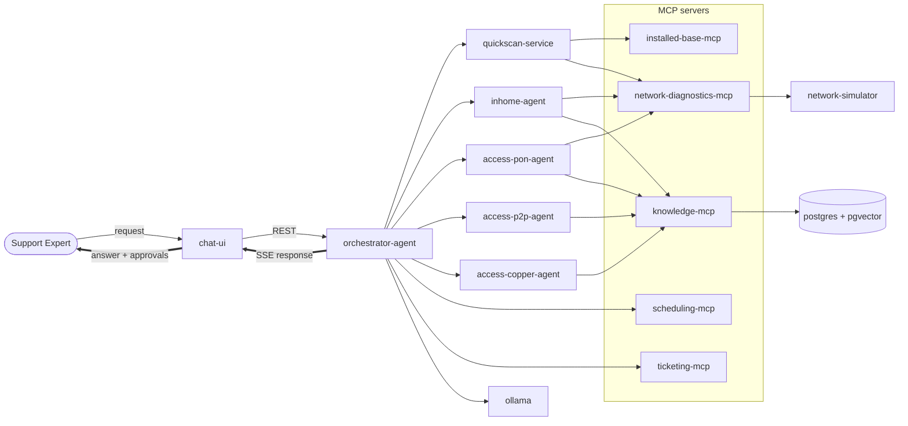

# DBA POC — Local Multi-Agent Connectivity Troubleshooting Assistant

[](https://github.com/developer47-ai/dba-poc/actions/workflows/ci.yml)
[](https://codespaces.new/developer47-ai/dba-poc?quickstart=1)
[](LICENSE)

A fully local, open-source proof of concept of an **enterprise AI agent platform**.
A customer support expert chats with an AI assistant that diagnoses a customer's
*"no internet"* problem end-to-end: it measures the line, routes the case to the right
specialist agent, follows the official troubleshooting procedure (SOP), asks for human
approval before risky actions, and books an engineer or opens a ticket when needed.

Everything runs on a laptop with `docker compose` — no cloud, no hosted LLM, no licensed tools.

> **Disclaimer** — This is a clean-room demo. The telecom operator **"NetCo"**, its customers,
> devices, procedures and backend systems are fictional and simulated. No proprietary code,
> prompts or data from any company are included.

---

## What it demonstrates

| Capability | How it shows up in the product |
|---|---|
| Multi-agent architecture | Orchestrator + In-Home, Access-PON, Access-P2P and Access-Copper specialist agents |
| Agent orchestration | Carrier-aware routing, agent hand-over and fallback reasoning in LangGraph |
| MCP | Five MCP servers (diagnostics, installed base, scheduling, ticketing, knowledge) over streamable HTTP |
| Tool calling | Agents call diagnostic and fulfilment tools on a simulated network |
| RAG & knowledge search | Hybrid (keyword + vector) search over SOP documents with citations |
| Document processing | SOPs (Markdown / PDF / DOCX) parsed and chunked with Docling |
| Workflow execution | SOP procedures executed step by step as a deterministic graph |
| Human-in-the-loop | Expert approves device reboots, Wi-Fi resets, engineer visits and swap orders |
| Memory | Conversation checkpoints, session context and long-term customer memory |
| Observability | LLM/agent traces in Langfuse, distributed traces in Jaeger |
| Local LLM | Qwen3 + bge-m3 served by Ollama (CPU or GPU) |

## Architecture



Detailed diagrams and design decisions will be added under `docs/` as the steps progress.

## Repository layout (target)

```text
dba-poc/
├── services/
│   ├── chat-ui/                      # Streamlit expert console
│   ├── orchestrator-agent/           # FastAPI + LangGraph supervisor, SSE
│   ├── quickscan-service/            # Initial line measurements
│   ├── agents/                       # inhome | access-pon | access-p2p | access-copper
│   ├── mcp/                          # network-diagnostics | installed-base | scheduling | ticketing | knowledge
│   ├── network-simulator/            # Stateful fake network with scenario customers
│   └── kb-ingestion/                 # Docling SOP ingestion worker
├── libs/poc-common/                  # Shared: settings, LLM factory, MCP client, events, logging
├── knowledge/sop/                    # SOP documents (source of truth for RAG)
├── data/scenarios/                   # Fictional customers and fault scenarios
├── infra/                            # Postgres init, Langfuse, Traefik, Keycloak config
├── evaluation/                       # Golden question sets and RAG/agent evaluation
├── scripts/                          # setup / demo helpers (PowerShell + bash)
├── docs/                             # Architecture, ADRs, demo script
└── docker-compose.yml
```

## Quick start

The platform layer (LLM, database, cache) is available now; the chat UI arrives in milestone **M1**.

```bash
git clone https://github.com/developer47-ai/dba-poc.git
cd dba-poc
docker compose up -d            # first start downloads ~3.5 GB of models (a few minutes)
./scripts/smoke-test.sh         # Windows: .\scripts\smoke-test.ps1
```

All settings have working defaults. To override them (for example `OLLAMA_CHAT_MODEL=qwen3:8b`),
create a `.env` file next to `docker-compose.yml`; see the variables used in the compose file.
NVIDIA GPU users: `docker compose -f docker-compose.yml -f docker-compose.gpu.yml up -d`.

| Service | Port (localhost only) | Purpose |
|---|---|---|
| Ollama | 11434 | Local LLM, OpenAI-compatible API at `/v1` |
| PostgreSQL + pgvector | 5432 | Data and vector search (user `dba`, db `dba`) |
| Valkey | 6379 | Cache and rate limits |

**Requirements:** a Docker-compatible runtime (Rancher Desktop, Docker Engine or Podman),
16 GB RAM minimum (32 GB recommended), ~25 GB free disk. A GPU is optional.

### Ways to run it

| Where | How | Best for |
|---|---|---|
| **GitHub Codespaces** (no install) | Click the *Open in GitHub Codespaces* badge (4 cores / 16 GB), then `docker compose up -d` and `bash scripts/smoke-test.sh` in its terminal | Trying it from any browser |
| **Your machine with Docker** | The commands above | Full speed, recording demos |
| **Python only, no Docker** | `uv sync --python 3.12 --extra llm --all-packages` then `uv run pytest` | Developing services; tests use a scripted model |
| **Python + native Ollama** | Install [Ollama](https://ollama.com/download), `ollama pull qwen3:4b` and `ollama pull bge-m3`, then `RUN_LLM_TESTS=1 uv run pytest -m llm` | Agent work against the real local model when containers are not available |

Every push is also checked by [CI](.github/workflows/ci.yml): lint and tests, then the container
platform is started, the models are downloaded and the smoke test runs.

## Roadmap

Built step by step; each step is one pull request and ends in something you can run.

### Phase A — Foundation
- [x] **Step 0 — Repository foundation**: license, git hygiene, secret scanning, roadmap
- [x] **Step 1 — Local platform**: `docker-compose.yml` with Ollama, Postgres + pgvector, Valkey; automatic model pull; health checks; smoke test
- [x] **Step 2 — Shared library** `poc-common`: config, OpenAI-compatible LLM factory, MCP client, event models, structured logging with correlation IDs

### Phase B — Walking skeleton → **M1: first end-to-end troubleshooting in chat**
- [x] **Step 3 — Network simulator + `network-diagnostics-mcp`** with scenario customers
- [x] **Step 4 — `inhome-agent`** (LangGraph agent with MCP tool calling, read-only, SSE stream)
- [ ] **Step 5 — `orchestrator-agent`** (FastAPI, SSE streaming, single route)
- [ ] **Step 6 — `chat-ui`** (session start, streaming answers)

### Phase C — Knowledge & process → **M2: SOP-guided troubleshooting with citations**
- [ ] **Step 7 — SOP library + `kb-ingestion` + `knowledge-mcp`** (hybrid search, SOP step graph)
- [ ] **Step 8 — SOP-guided agents** (follow steps, cite `sop_id/step_id`, no-SOP fallback)

### Phase D — Full multi-agent platform → **M3: all scenarios**
- [ ] **Step 9 — `installed-base-mcp` + `quickscan-service`**
- [ ] **Step 10 — Access PON / P2P / Copper agents**, carrier routing and agent hand-over
- [ ] **Step 11 — Human-in-the-loop**: consent, `scheduling-mcp`, `ticketing-mcp`, approval UI
- [ ] **Step 12 — Memory**: Postgres checkpointer, session cache, customer memory

### Phase E — Operate & share → **v0.1.0 release**
- [ ] **Step 13 — Observability**: Langfuse, OpenTelemetry, Jaeger, feedback scores
- [ ] **Step 14 — Guardrails & identity**: input guardrails, scope gate, optional Traefik + Keycloak
- [ ] **Step 15 — Evaluation & CI**: golden sets, RAG metrics, GitHub Actions
- [ ] **Step 16 — Visitor packaging**: one-command setup, demo script, screenshots, release

## Planned demo scenarios

Fictional customers live in [`data/scenarios/`](data/scenarios); the
[network simulator](services/network-simulator) keeps their live state and the
[diagnostics MCP server](services/mcp/network-diagnostics) exposes 12 tools on top of it
(9 read-only, 3 that change state and will need human approval).

| Customer | Fault | Agents involved | Remote fix? | Human approval |
|---|---|---|---|---|
| C1001 fiber GPON, LOS red | No optical signal | Access-PON | No | Engineer appointment |
| C1002 fiber XGSPON, modem stuck | PPP session stuck | In-Home | Reboot modem | Remote reboot |
| C1003 fiber GPON, Wi-Fi changed | Wrong Wi-Fi settings | In-Home | Reset Wi-Fi | Wi-Fi reset |
| C1004 copper VDSL, modem faulty | Hardware fault | Access-Copper → In-Home | No | Modem swap order |
| C1005 fiber EoF, port down | Access port down | Access-P2P | No | Incident ticket |
| C1006 fiber GPON, healthy | None (control) | In-Home | – | – |

## Tech stack

| Layer | Technology | License |
|---|---|---|
| LLM runtime | Ollama (Qwen3, bge-m3) | MIT / Apache-2.0 |
| Agents & workflows | LangGraph, LangChain | MIT |
| Tool protocol | MCP Python SDK / FastMCP | MIT |
| API | FastAPI | MIT |
| UI | Streamlit | Apache-2.0 |
| Database & vectors | PostgreSQL + pgvector | PostgreSQL |
| Cache | Valkey | BSD-3 |
| Document processing | Docling | MIT |
| Observability | Langfuse, OpenTelemetry, Jaeger | MIT / Apache-2.0 |
| Gateway & identity (optional) | Traefik, Keycloak | MIT / Apache-2.0 |

## Contributing

Python code uses [uv](https://docs.astral.sh/uv/) and Python 3.12:

```bash
uv sync --python 3.12 --extra llm --all-packages
uv run pytest
uv run ruff check .
```

1. `pip install pre-commit && pre-commit install` — blocks secrets and large files.
2. One step = one branch = one pull request.
3. Never commit real customer data, company code, internal URLs or credentials.

## License

[MIT](LICENSE) © 2026 Ayush Kumar
