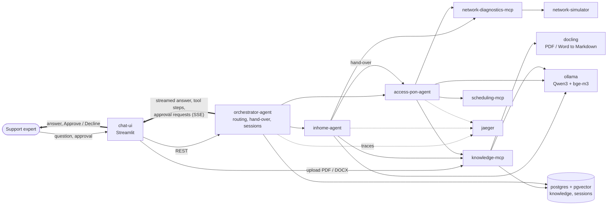

# DBA POC — Local Multi-Agent Troubleshooting Assistant

[](https://github.com/developer47-ai/dba-poc/actions/workflows/ci.yml)
[](https://codespaces.new/developer47-ai/dba-poc?quickstart=1)
[](LICENSE)

A fully local, open-source proof of concept of an **orchestrated multi-agent AI platform**.
A customer support expert chats with an assistant that diagnoses a customer's *"no internet"*
problem: it measures the line with tools, follows the official troubleshooting procedure (SOP),
hands the case from the **In-Home agent** to the **Access-PON agent** when the fault is outside
the home, asks the expert for **approval** before anything changes (a modem reboot, a Wi-Fi reset,
an engineer booking), and cites the procedure or document behind every answer.

Everything runs with `docker compose` on one machine: **no cloud, no API keys, no hosted LLM, no
licensed software.** The language model runs locally in Ollama.

> **Disclaimer** — This is a clean-room demo. The telecom operator **"NetCo"**, its customers,
> devices, procedures and backend systems are fictional and simulated. No proprietary code,
> prompts or data from any company are included.

## What it demonstrates

| Capability | How it shows up |
|---|---|
| Multi-agent architecture | An orchestrator and two specialist agents (In-Home, Access-PON), each a separate service |
| Agent orchestration | The orchestrator routes each turn and hands a case over between agents, chosen by the SOP and the customer's carrier technology |
| MCP | Three MCP servers over streamable HTTP: diagnostics, scheduling, knowledge |
| Tool calling | Agents read line status, reboot devices, reset Wi-Fi, search and book engineer slots |
| RAG and knowledge search | Hybrid keyword + vector search (bge-m3, pgvector) over SOPs and reference documents, with citations |
| Document processing | PDF / Word / PowerPoint files are converted by **Docling**, indexed and cited like any SOP |
| Workflow execution | Each SOP runs step by step as a LangGraph workflow; the procedure, not the model, decides the path |
| Human-in-the-loop | State-changing actions wait for **Approve / Decline**; every decision is audited |
| Memory | Cases are stored in Postgres, survive a restart and can be resumed; agents see the last 12 messages |
| Observability | One OpenTelemetry trace per chat turn in **Jaeger**: agents, SOP steps, LLM calls, tool calls |
| Chat interface | Streamlit console that streams the answer token by token and shows every tool step live |
| Local LLM | Qwen3-4B Instruct and bge-m3 served by Ollama (CPU or NVIDIA GPU) |

**Deliberately not included** (this is a minimal POC): Access-P2P and Access-Copper agents,
installed-base and ticketing services (steps that need them stop with a clear
"not part of this demo" message), authentication and guardrails, scanned-PDF OCR, Langfuse.
Valkey is started for future caching but nothing uses it yet.

## Architecture



Both specialist agents run the same SOP engine ([`libs/sop-agent`](libs/sop-agent)) and differ in
scope, procedures and tools. Routing is rule-based and auditable: an SOP names the next agent, or
the customer's carrier technology decides. Agents never talk to each other directly; every
hand-over goes through the orchestrator.

## Quick start

### Requirements

| | |
|---|---|
| Docker | Docker Engine or Docker Desktop with **Compose v2** (`docker compose version`). On Windows use Docker Desktop with the WSL 2 backend |
| Memory | 16 GB RAM for Docker at minimum (32 GB recommended). Docker Desktop: *Settings → Resources → Memory* at least 12 GB |
| Disk | About 25 GB free (images about 9 GB, models 3.5 GB) |
| Internet | Needed on the first start only (images and models) |
| CPU | x86-64 (tested in CI) or ARM64 such as Apple Silicon (all images are multi-arch, not tested). A GPU is optional |
| Free ports | 8501, 8000, 16686, 5001, 8105, 11434, 5432, 6379 on localhost (see *Configuration* to change them) |

### Start

```bash
git clone https://github.com/developer47-ai/dba-poc.git
cd dba-poc
docker compose up -d
```

The first start builds nine small images, pulls the others and **downloads the models**, so the
command can run for **10–30 minutes** depending on your connection. That is normal: it waits for the
models before it starts the agents. Later starts take well under a minute.

Check that everything is up:

```bash
docker compose ps
```

All services should be `running` or `healthy`; `ollama-init` and `kb-ingestion` are one-time jobs
and show `exited (0)`. Then open **http://localhost:8501**.

### Try it (about 10 minutes)

On a CPU each answer takes roughly **1–2 minutes**; the activity panel shows progress while the
model works. Pick a customer in the sidebar, click **Start new session**, then:

| # | Customer | Type this | What you should see |
|---|---|---|---|
| 1 | C1002 | *The customer reports they have no internet. Please diagnose the connection.* | The In-Home agent follows SOP-IH-001: checks the PPP session and lights, then stops with an **approval request to reboot the modem**. Click **Approve**: it reboots, re-checks and the case is resolved |
| 2 | C1001 | the same message | The In-Home agent finds the fault is outside the home and **hands over to the Access-PON agent** (SOP-PON-001). It finds engineer slots and asks approval to **book** one. Approve: the appointment is booked |
| 3 | C1003 | *The customer's laptop cannot connect to the wifi* | SOP-IH-002, approval to **reset the Wi-Fi** to the sticker settings |
| 4 | any | *What do the LED lights on the modem mean?* | A knowledge answer with citations (for example KB-LED-001), no procedure |
| 5 | any | In the sidebar open **Add a document**, upload [`data/documents/FibreLink-ONT-100-quick-guide.docx`](data/documents), then ask *How long do I hold the reset button of the FibreLink ONT-100?* | Docling converts the file; the answer says **12 seconds** and cites the uploaded document |
| 6 | C1001 | Run `docker compose restart orchestrator`, reload the page, choose **Earlier cases of this customer → Resume this case** | The conversation is back, including a pending approval |

Under every answer, **Open this turn's trace in Jaeger** shows the whole turn: both agents, every
SOP step, LLM call and tool call with timings. **Reset customer's network** restores a scenario so
you can run it again.

To check the installation without the UI, run `python scripts/e2e_check.py` (Python 3 only, about 10
minutes). It runs the same scenarios against your running stack and prints PASSED or what failed.

### Stop and clean up

```bash
docker compose stop        # stop, keep everything (models, cases, uploaded documents)
docker compose down        # remove the containers, keep the data
docker compose down -v     # remove everything, including the downloaded models and all data
```

### Configuration

Defaults work out of the box. To change something, create a text file named `.env` next to
`docker-compose.yml` with lines like `OLLAMA_PORT=11435`:

| Variable | Default | Purpose |
|---|---|---|
| `CHAT_UI_PORT`, `ORCHESTRATOR_PORT`, `JAEGER_UI_PORT`, `DOCLING_PORT`, `KNOWLEDGE_MCP_PORT`, `OLLAMA_PORT`, `POSTGRES_PORT`, `VALKEY_PORT` | see the table below | Host ports, if one is already in use |
| `OLLAMA_CHAT_MODEL` | `qwen3:4b-instruct-2507-q4_K_M` | Chat model, for example `qwen3:8b` (better, slower) |
| `LLM_THINKING` | `false` | Let hybrid Qwen3 models think before answering (much slower on a CPU) |
| `SESSION_STORE` | `postgres` | `memory` keeps cases in RAM only |

NVIDIA GPU: `docker compose -f docker-compose.yml -f docker-compose.gpu.yml up -d` (needs the NVIDIA
Container Toolkit). The default model is the *instruct* variant on purpose: the plain `qwen3:4b`
tag is thinking-only and several times slower on a CPU.

| Service | Port (localhost only) | Purpose |
|---|---|---|
| Chat UI (Streamlit) | 8501 | Expert console |
| Orchestrator | 8000 | Sessions and streamed turns (`/docs` for the API) |
| Jaeger UI | 16686 | Traces of every chat turn |
| Docling | 5001 | Document conversion API (`/docs`) |
| Knowledge MCP | 8105 | Search and document upload; try `/v1/search?q=LOS+light+red` |
| Ollama | 11434 | Local LLM, OpenAI-compatible API at `/v1` |
| PostgreSQL + pgvector | 5432 | Knowledge, vectors and cases (user `dba`, db `dba`) |
| Valkey | 6379 | Reserved for caching, not used yet |

The agents, the other MCP servers and the network simulator are only reachable inside the Docker
network. Nothing is protected by a login: keep the ports on localhost.

### Troubleshooting

| Problem | What to do |
|---|---|
| `port is already allocated` or `address already in use` | Another program uses that port (often 5432 or 11434). Put a different port for it in `.env` and run `docker compose up -d` again |
| The UI says *Orchestrator not reachable* | The stack is still starting. Check `docker compose ps` and `docker compose logs -f orchestrator` |
| A container shows `Exited (137)` or the machine freezes | Out of memory. Give Docker at least 12 GB (16 GB recommended) and close other programs |
| The start seems stuck | Probably the model download: `docker compose logs -f ollama-init`. If it fails, run `docker compose up -d` again; it resumes |
| Answers take very long | Expected on a CPU (1–2 minutes). A GPU or a smaller load on the machine helps. Do not switch on `LLM_THINKING` |
| The first PDF upload is slow | Docling loads its models on first use; later uploads are faster |
| A step says *not part of this demo* | The customer or procedure needs a service this POC leaves out (ticketing, P2P / Copper agents). Use C1001, C1002 or C1003 |
| Something is broken after changes or an interrupted start | `docker compose down -v` and start again (downloads the models again) |
| Need the logs | `docker compose logs --tail 200 <service>`; services are listed by `docker compose ps` |

## Other ways to run it

| Where | How |
|---|---|
| **GitHub Codespaces** (no install) | Click the *Open in GitHub Codespaces* badge (4 cores, 16 GB), run `docker compose up -d` in the terminal, then open the forwarded ports **8501** (chat UI) and **16686** (Jaeger). Not covered by CI: if something looks off in the browser, see the Codespaces note below |
| **Python only, no Docker** | `uv sync --python 3.12 --extra llm --all-packages`, then `uv run pytest`. The tests use a scripted model and in-memory stores; the Postgres tests run when `RUN_PG_TESTS=1` and `DATABASE_URL` are set |

*Codespaces note:* the devcontainer points the Jaeger link at the forwarded port and relaxes
Streamlit's CSRF check, which does not work behind the Codespaces proxy; the platform itself is the
same as locally.

## How it is checked

Every push runs [CI](.github/workflows/ci.yml) on a clean checkout:

1. Lint, the SOP library validator and about 280 tests (including real Postgres + pgvector).
2. **The quick start above, literally**: `docker compose up -d` on a fresh checkout with the real
   local model, then `scripts/e2e_check.py`, which verifies knowledge search, Docling conversion of
   a Word and a PDF file, a chat answer that cites the uploaded document, an approved reboot, a
   hand-over to the Access-PON agent with an approved booking, one Jaeger trace across the
   orchestrator and both agents, and that a restarted orchestrator still has the case.

The run page lists the measured latencies. CI runs on x86-64 Linux; Windows, macOS and ARM are
expected to work but are not tested.

## Demo scenarios

Fictional customers live in [`data/scenarios/`](data/scenarios); the
[network simulator](services/network-simulator) keeps their live state.

| Customer | Fault | Result in this demo |
|---|---|---|
| C1001 fiber GPON, LOS red | No optical signal | In-Home → hand-over → Access-PON, **engineer booking with approval** |
| C1002 fiber XGS-PON, modem stuck | PPP session stuck | In-Home, **modem reboot with approval** |
| C1003 fiber GPON, Wi-Fi changed | Wrong Wi-Fi settings | In-Home, **Wi-Fi reset with approval** |
| C1004 copper VDSL, modem faulty | Hardware fault | Diagnosed; the follow-up needs the ticketing service, so it stops with an explanation |
| C1005 fiber EoF, port down | Access port down | Hand-over needs the Access-P2P agent, which is not built: reported as unavailable |
| C1006 fiber GPON, healthy | None (control) | In-Home finds nothing wrong |

## Repository layout

```text
dba-poc/
├── services/
│   ├── chat-ui/                 # Streamlit expert console
│   ├── orchestrator-agent/      # FastAPI: sessions, routing, hand-over, SSE relay, memory
│   ├── agents/inhome/           # In-Home agent (a thin spec on libs/sop-agent)
│   ├── agents/access-pon/       # Access-PON agent
│   ├── mcp/                     # network-diagnostics | scheduling | knowledge (MCP servers)
│   └── network-simulator/       # Stateful fake network with scenario customers
├── libs/
│   ├── poc-common/              # Settings, LLM factory, MCP client, events, tracing, logging
│   ├── sop-agent/               # SOP-guided agent engine (LangGraph workflow, approvals)
│   ├── sop-kit/                 # SOP parser, validator, chunker, step navigator
│   └── knowledge-base/          # Postgres/pgvector store, ingestion, hybrid search, Docling client
├── knowledge/                   # SOP procedures and reference documents (source of truth for RAG)
├── data/                        # scenarios/ (fictional customers), documents/ (sample Word + PDF)
├── infra/                       # Dockerfile and Postgres init
├── scripts/                     # smoke test, end-to-end check, sample document generator
├── .devcontainer/               # GitHub Codespaces setup
└── docker-compose.yml
```

## Tech stack

| Layer | Technology | License |
|---|---|---|
| LLM runtime | Ollama (Qwen3, bge-m3) | MIT / Apache-2.0 |
| Agents and workflows | LangGraph, LangChain | MIT |
| Tool protocol | MCP Python SDK (FastMCP) | MIT |
| API | FastAPI | MIT |
| UI | Streamlit | Apache-2.0 |
| Database and vectors | PostgreSQL + pgvector | PostgreSQL |
| Document processing | Docling (docling-serve) | MIT |
| Observability | OpenTelemetry, Jaeger | Apache-2.0 |
| Cache (reserved) | Valkey | BSD-3 |

## How the pieces work

- **SOP-guided agents:** each procedure in [`knowledge/sop/`](knowledge/sop) is a validated graph of
  steps. The agent runs a step's tool, the model only picks one of the step's allowed outcomes, and
  the knowledge service returns the next step. Steps that change something need approval.
- **Approvals:** the agent stops and asks; the orchestrator accepts only the pending request, logs
  the decision, and the agent re-checks it before running the action. The decision carries no
  arguments, so it cannot change what is executed.
- **Documents:** an upload can only become a *reference*, never a procedure, so an unreviewed file
  can inform an answer but cannot tell an agent which action to run. Uploading and removing are
  plain HTTP routes, not MCP tools, so agents cannot change the knowledge base.
- **Memory:** Postgres table `agent.session` is written after every turn; a pending approval
  survives a restart. Agents receive only the last 12 messages.
- **Traces:** the W3C `traceparent` header carries one trace from the orchestrator through the
  agents. Tracing is off when `OTEL_EXPORTER_OTLP_ENDPOINT` is not set.

More detail per service: [orchestrator](services/orchestrator-agent/README.md),
[In-Home agent](services/agents/inhome/README.md),
[Access-PON agent](services/agents/access-pon/README.md),
[knowledge MCP](services/mcp/knowledge/README.md).

## Contributing

Python code uses [uv](https://docs.astral.sh/uv/) and Python 3.12:

```bash
uv sync --python 3.12 --extra llm --all-packages
uv run pytest
uv run ruff check .
uv run python -m sop_kit knowledge     # validate the SOP library
```

1. `pip install pre-commit && pre-commit install` — blocks secrets and large files.
2. Never commit real customer data, company code, internal URLs or credentials.

## License

[MIT](LICENSE) © 2026 Ayush Kumar
