# Architecture of the DBA POC

This document describes the whole system: what is built today, how the pieces work together, and
what is planned. It is written from the code. Where something is not built, it says so.

**Legend:** ✅ built and verified in CI · 🔜 planned, not built · ⛔ out of scope for this POC.
In the diagrams, dashed grey boxes are planned.

**Contents**
1. [The system at a glance](#1-the-system-at-a-glance)
2. [Components](#2-components)
3. [Life of a chat turn](#3-life-of-a-chat-turn)
4. [Agent orchestration](#4-agent-orchestration)
5. [Inside an agent: the SOP workflow engine](#5-inside-an-agent-the-sop-workflow-engine)
6. [SOPs: procedures as data](#6-sops-procedures-as-data)
7. [MCP servers, tool calling and execution](#7-mcp-servers-tool-calling-and-execution)
8. [Human-in-the-loop approval](#8-human-in-the-loop-approval)
9. [RAG: ingestion, hybrid search and Reciprocal Rank Fusion](#9-rag-ingestion-hybrid-search-and-reciprocal-rank-fusion)
10. [Context building: what the LLM sees](#10-context-building-what-the-llm-sees)
11. [Memory and state](#11-memory-and-state)
12. [Observability](#12-observability)
13. [Safety controls and known gaps](#13-safety-controls-and-known-gaps)
14. [Deployment and CI](#14-deployment-and-ci)
15. [Planned work](#15-planned-work)
16. [Design decisions and trade-offs](#16-design-decisions-and-trade-offs)

---

## 1. The system at a glance

A support expert chats with an assistant about a customer's *"no internet"* problem. The system
does not let the language model improvise. **Approved procedures (SOPs) decide what happens next;
the model only reads results and picks one of a few allowed outcomes, and writes the answer.**

Design principles:

| Principle | How it is applied |
|---|---|
| Procedure first, model second | An SOP is a validated graph of steps. Code runs the step's tool, the model picks an allowed outcome, the knowledge service returns the next step |
| Humans approve changes | Every step that changes something waits for Approve / Decline. The validator rejects a procedure that tries to skip this |
| Ground every answer | Answers cite the SOP step or document passage they come from. No matching knowledge means a fixed "not covered" reply, without calling the model |
| Stateless agents, stateful orchestrator | Agents keep no memory between turns. The orchestrator stores each agent's position and sends it back |
| Everything local | Ollama runs the models, Postgres holds knowledge and cases, nothing leaves the machine |
| Stream everything | Tool steps and answer tokens reach the expert while the agent still works (Server-Sent Events) |

### Container view

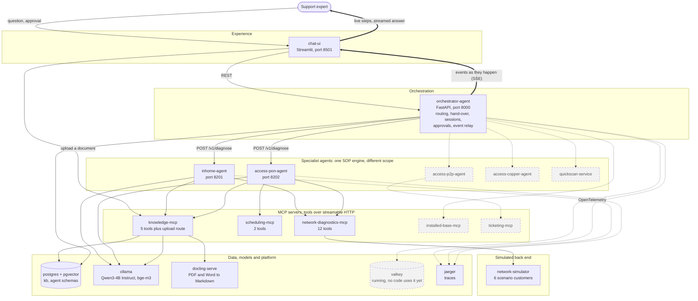

---

## 2. Components

| Component | Status | Role | Code |
|---|---|---|---|
| chat-ui | ✅ | Streamlit console: customer and session selection, live activity panel, streamed answer, Approve / Decline, earlier cases, document upload, trace link | [`services/chat-ui`](../services/chat-ui) |
| orchestrator-agent | ✅ | Sessions, routing, agent hand-over, approval endpoint and audit log, SSE relay with heartbeats, session persistence, tracing root | [`services/orchestrator-agent`](../services/orchestrator-agent) |
| inhome-agent | ✅ | Specialist for problems inside the home: modem, lights, Wi-Fi, devices | [`services/agents/inhome`](../services/agents/inhome) |
| access-pon-agent | ✅ | Specialist for fiber (GPON, XGS-PON) faults up to the ONT; books engineer visits | [`services/agents/access-pon`](../services/agents/access-pon) |
| sop-agent (library) | ✅ | The shared engine both agents run: LangGraph workflow, constrained decisions, approvals, hand-over, exploratory fallback | [`libs/sop-agent`](../libs/sop-agent) |
| network-diagnostics-mcp | ✅ | 9 read-only tools and 3 state-changing tools on the simulated network | [`services/mcp/network-diagnostics`](../services/mcp/network-diagnostics) |
| scheduling-mcp | ✅ | `search_appointment_slots` (read-only), `book_appointment` (state-changing) | [`services/mcp/scheduling`](../services/mcp/scheduling) |
| knowledge-mcp | ✅ | Hybrid search, SOP lookup and step navigation as tools; HTTP routes for upload and delete | [`services/mcp/knowledge`](../services/mcp/knowledge) |
| network-simulator | ✅ | Stateful fake network with six scenario customers (reboots and resets really change it) | [`services/network-simulator`](../services/network-simulator) |
| sop-kit, knowledge-base (libraries) | ✅ | SOP parser, validator, chunker, navigator; stores, ingestion, retriever, Docling client | [`libs/sop-kit`](../libs/sop-kit), [`libs/knowledge-base`](../libs/knowledge-base) |
| poc-common (library) | ✅ | Config, event model, LLM factory, MCP client, tracing, logging | [`libs/poc-common`](../libs/poc-common) |
| Ollama | ✅ | Serves the chat model and the embedding model through an OpenAI-compatible API | compose |
| PostgreSQL + pgvector | ✅ | Knowledge documents and chunks (`kb` schema), cases (`agent` schema) | compose, [`infra/postgres`](../infra/postgres) |
| Docling | ✅ | Converts PDF, Word, PowerPoint and HTML to Markdown (official docling-serve CPU image) | compose |
| Jaeger | ✅ | Stores and shows the traces; in memory | compose |
| Valkey | ⚠️ running, unused | Started (256 MB, LRU, no persistence) for future caching; no code reads or writes it | compose, [section 15](#15-planned-work) |
| access-p2p-agent, access-copper-agent | 🔜 | Specialists for point-to-point and copper lines. Their SOPs already exist in the library | [section 15](#15-planned-work) |
| installed-base-mcp, quickscan-service | 🔜 | Customer's installed equipment and the first line measurements | [section 15](#15-planned-work) |
| ticketing-mcp | 🔜 | Incidents and swap orders | [section 15](#15-planned-work) |

---

## 3. Life of a chat turn

One troubleshooting turn for customer C1002 (stuck modem), from the expert's message to the pause
at the approval request:

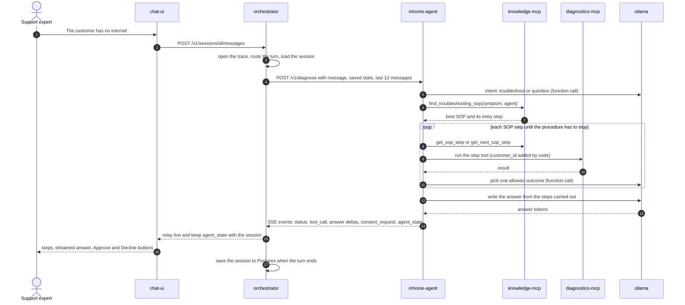

What travels on the wire is a stream of typed events (SSE). The expert sees steps while the model
is still working.

| Event | Meaning |
|---|---|
| `status_update` | Progress: routing, intent, `sop_selected`, `sop_step`, `sop_outcome`, `reasoning`, `trace`, `handover_unavailable`, `consent_resolved` |
| `tool_call` | A tool started or completed, with arguments and result |
| `knowledge_article` | A document or SOP the answer relies on, with its citation |
| `agent_message_delta` / `agent_message` | Answer tokens as they are generated, then the full text |
| `consent_request` | The agent waits for an approval |
| `agent_handoff` | The case moves to another agent, with the findings so far |
| `agent_state` | Internal: the agent's resumable position. Stored by the orchestrator, never shown |
| `error`, `heartbeat`, `done` | Failure, keep-alive during slow model calls, end of turn |

Defined but not emitted today: `measurement_started`, `measurement_completed`,
`incident_suggestion`, `swap_order_suggestion`, `appointment_suggestion`, `consent_response`,
`session_created`. They are reserved for the planned services.

---

## 4. Agent orchestration

### What the orchestrator decides

| Decision | Rule |
|---|---|
| First agent of a case | Always the In-Home agent |
| Follow-up message | Goes to the **active agent**, so the expert's reply continues the same procedure |
| Hand-over target | The SOP names it (`handover_to: inhome` or `access-pon`), or for `access-network` the **customer's carrier technology** decides: GPON and XGS-PON go to `access-pon-agent` |
| No agent for the target | EoF/GoF and copper have no agent yet: the turn ends with a `handover_unavailable` explanation |
| Loop protection | At most **2 hand-overs per turn**; a hand-over to the same agent is refused |
| What the next agent receives | `Handed over from <agent> (<SOP step>). Findings so far: <checks and outcomes, 600 characters>. Expert's request: <message>`, plus its own saved state if it has one from earlier in the case |
| Approvals | A decision goes to the agent that asked, only on the first hop |
| Context given to agents | The last **12 messages** of the chat. The stored chat stays complete |

Routing is **rule-based and auditable**, not an LLM deciding. The carrier technology comes from the
installed-base record (today read from the simulator; the planned installed-base-mcp replaces it).

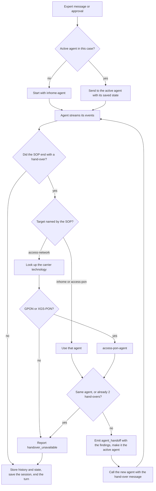

### Hand-over in time

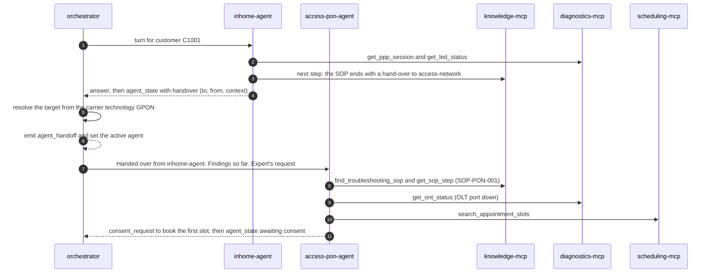

The trace of such a turn shows two `agent.call` spans below one `turn` span.

---

## 5. Inside an agent: the SOP workflow engine

Both specialist agents are the same program ([`libs/sop-agent`](../libs/sop-agent)) with a different
`AgentSpec`: name, role text, domain rule and port. What makes them different is the SOPs and tools
their scope allows. The engine is a **LangGraph** graph with seven nodes:

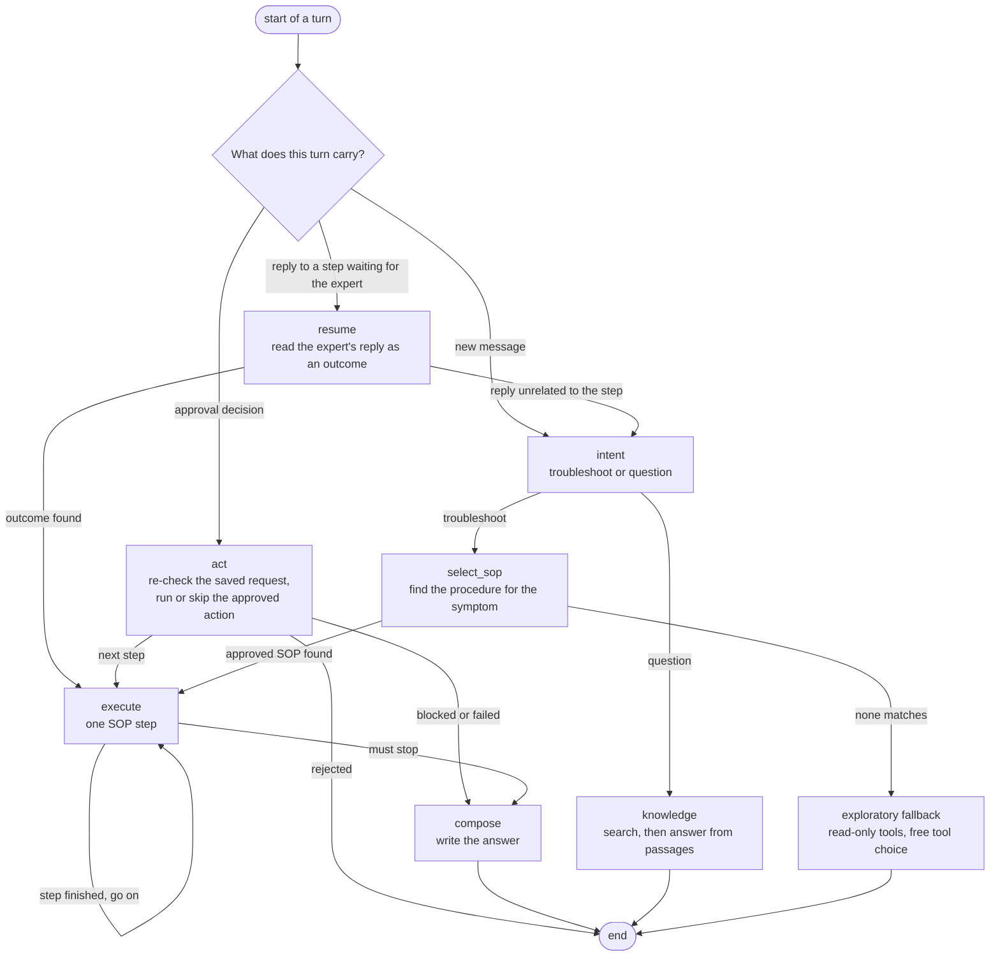

A step is **executed** like this:

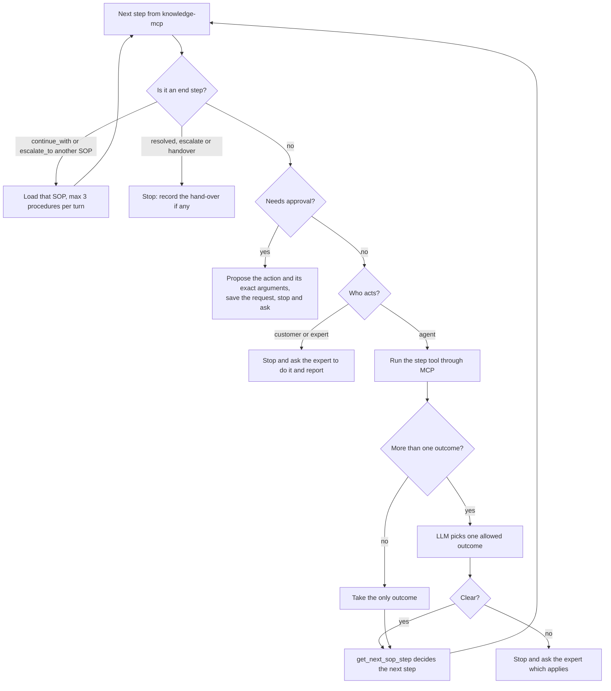

Limits per turn: **15 steps**, **3 procedures** (chained with `continue_with` or `escalate_to`).
If no approved SOP matches a troubleshooting request, the agent says so and falls back to an
**exploratory** check: the model chooses among the **read-only** tools only and answers in the
format Findings, Diagnosis, Recommended next step.

---

## 6. SOPs: procedures as data

A procedure is a Markdown file in [`knowledge/sop/`](../knowledge/sop) with YAML metadata and a
`## Procedure` section of steps. The library has 8 SOPs and 2 reference articles.

```markdown
---
doc_id: SOP-IH-001
title: No internet while the modem is online
agent_scope: [inhome]
carrier_tech_types: [GPON, XGSPON, VDSL, EOF, GOF]
symptoms: [no internet, internet light orange, PPP session down]
entry_step: S1
---
### S1 — Check the internet session
- actor: agent
- tool: network-diagnostics.get_ppp_session
- next: { up: S7, down: S2 }
Read the PPP session status. Outcome `up` if the status is up, `down` otherwise.
```

Each step names: **actor** (agent, customer or expert), an optional **tool**, `requires_consent`,
`next` (outcome to step) or an `end` (resolved, escalate, handover, continue). The step's text holds
the decision rules the model applies to the tool result.

Example, SOP-IH-001 (no internet while the modem is online):

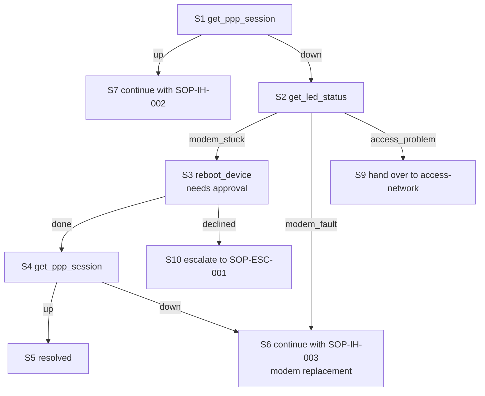

**Validation** ([`sop-kit`](../libs/sop-kit)) runs in CI and before ingestion, so a broken procedure
never reaches the agents. It checks that:

- ids follow `SOP-XX-nnn` or `KB-XXX-nnn`, and every `agent_scope` is a known agent
- the entry step exists, step ids are unique, every step has an instruction and either `next`
  outcomes or an `end`, and every outcome points to an existing step
- every step is **reachable** from the entry step, and none is a **loop without an exit**
- a tool must exist in the **tool catalog**, only an `agent` step may call a tool, and the catalog
  says whether the tool changes state
- **a state-changing tool requires `requires_consent: true`**, and an approval step must have a
  `declined` outcome plus exactly one other outcome
- `escalate`, `handover` and `continue` ends name a valid target, and referenced SOPs exist
- no two files share a `doc_id`; reference documents contain no steps

The step navigator is deterministic code: `next_step(doc, step, outcome)` returns the next step or an
error. The model never decides the path.

---

## 7. MCP servers, tool calling and execution

All tools are served by **MCP servers** over streamable HTTP and called through one client
([`poc_common.mcp_client`](../libs/poc-common/src/poc_common/mcp_client.py)). Read-only tools are
marked `readOnlyHint`; state-changing ones are not.

| Server | Tool | Changes state? |
|---|---|---|
| network-diagnostics | `get_ppp_session`, `get_ppp_history`, `get_ont_status`, `get_access_port_status`, `get_led_status`, `get_device_details`, `get_wifi_settings`, `get_managed_devices`, `get_inhome_network_map` | no |
| network-diagnostics | `reboot_device`, `reset_wifi`, `factory_reset_device` | **yes** (approval) |
| scheduling | `search_appointment_slots` | no |
| scheduling | `book_appointment` | **yes** (approval) |
| knowledge | `search_knowledge`, `find_troubleshooting_sop`, `get_sop_procedure`, `get_sop_step`, `get_next_sop_step` | no |
| installed-base, ticketing | `get_installed_base`; `create_incident`, `create_swap_order` | 🔜 listed in the catalog, not built |

### Two ways tools are called

| | SOP path (normal) | Exploratory fallback |
|---|---|---|
| Who chooses the tool | **The SOP step names it**; code calls it | The LLM, through function calling |
| Which tools | Any tool of the step, including state-changing ones after approval | **Read-only tools only** |
| Used when | An approved procedure matches | No approved procedure matches |
| LLM's role | Picks one allowed outcome from the result | Chooses the next tool and writes the answer |

Rules that apply to both:

- **`customer_id` is added by the code**, never by the model. In the fallback it is removed from the
  tool schemas the model sees, so a small model cannot mix up customers.
- A tool error does not crash the turn: it is returned as text (`Tool error: ...`) so the procedure
  or model can react. An approved action that fails stops the procedure with an explanation.
- Every call is a trace span (`mcp.call_tool`) and carries the correlation id header.
- A tool named in a step that has no server yet (ticketing) stops the procedure with
  *"not part of this demo"* instead of improvising.

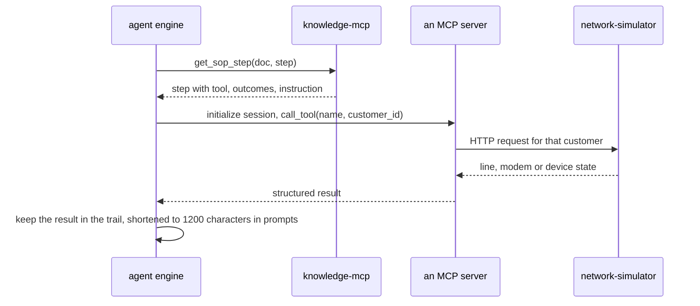

---

## 8. Human-in-the-loop approval

Anything that changes the customer's service waits for the expert. The mechanism is built so a
decision **cannot change what is executed**.

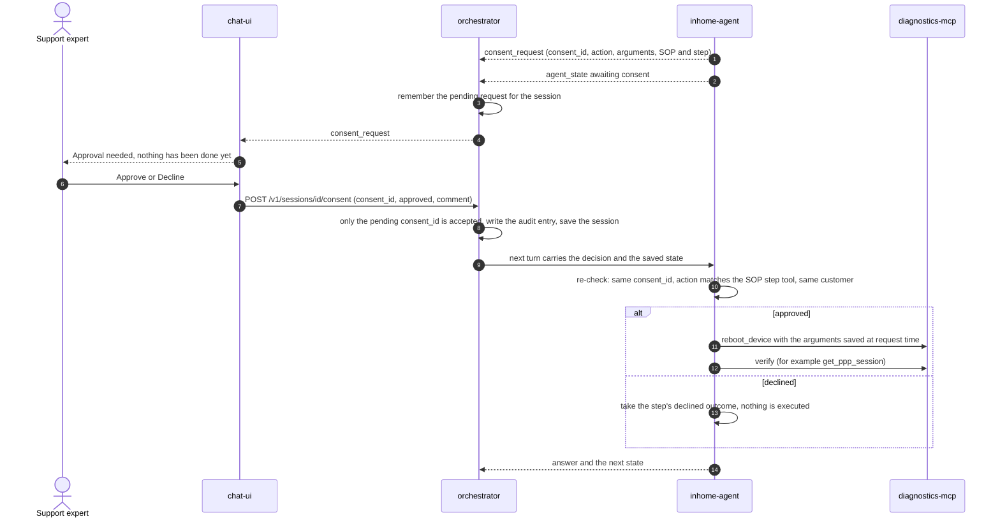

Guarantees: the request is bound to a `consent_id`; the decision carries **no arguments**; the agent
re-validates the saved request against the SOP step; a decision is used **once**; the audit log
records who decided what and when (the expert's typed name today). A pending request survives a
restart because the session is stored in Postgres.

---

## 9. RAG: ingestion, hybrid search and Reciprocal Rank Fusion

The retrieval design is **hybrid, structure-aware and filtered**, and the agents reach it as MCP
tools. It also serves **procedures**: what is retrieved for troubleshooting is a graph the agent
walks, not text the model paraphrases.

### 9.1 Ingestion

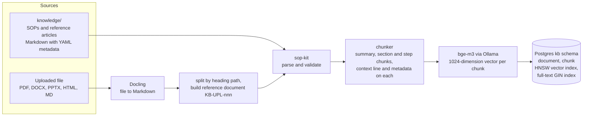

- **Library ingestion** (`kb-ingestion` job at start-up) is idempotent: unchanged documents (same
  checksum) are skipped, changed ones replaced atomically, and library documents that disappeared
  are removed. **Uploaded documents are never removed** by this sync.
- **Chunking follows the document structure:** one *summary* chunk per document (title, symptoms,
  technologies, scope), one chunk per *section* (tables kept whole, long text split at about 1,800
  characters on paragraph boundaries), one chunk per *procedure step* (so a citation can point to
  `SOP-IH-001 › S3`). Every chunk starts with a context line such as
  `SOP-IH-001 v1.0 › No internet while the modem is online › S3` and carries the document metadata
  (agent scope, carrier technologies, device models, kind) for filtering.
- **Uploads** become **reference** documents with a generated id and `source = upload:<file>`.
  Re-uploading the same file creates the next minor version. An upload can never become a
  procedure.
- **Stores:** `kb.document` holds the parsed document as JSON (so procedures can be navigated),
  `kb.chunk` holds text, metadata, the vector, and a generated English full-text vector.

### 9.2 Retrieval: hybrid search with Reciprocal Rank Fusion

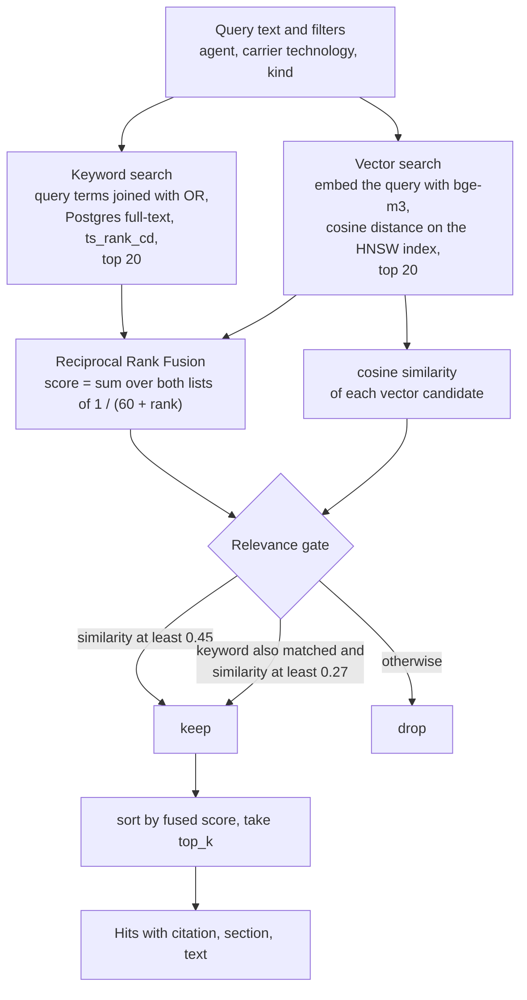

**Why hybrid.** Keyword search finds exact terms such as `LOS` or `PPP`. Vector search finds
meaning, such as "no light from the network". Each misses what the other finds.

**Reciprocal Rank Fusion (RRF).** Each list gives a chunk a rank. A chunk's fused score is the sum
of `1 / (60 + rank)` over the lists it appears in. It uses ranks, not raw scores, so two scales that
cannot be compared (a text-rank score and a cosine similarity) still combine fairly. A chunk ranked
well by both lists wins. The constant 60 keeps one first place from dominating.

**The relevance gate** is what makes "no answer" possible. A chunk is relevant only if its **meaning**
is close enough (cosine similarity at least **0.45**). A keyword match lowers the bar to
**0.27** (0.45 × 0.6) but cannot replace it, so one shared common word ("remote", "customer") does
not make an unrelated procedure relevant. A chunk found **only** by keyword search has no similarity
and is dropped. In CI, relevant questions scored about 0.68 to 0.71 and an off-topic question
returned nothing.

**Worked example** (invented numbers, same arithmetic as the code):

| Chunk | Keyword rank | Vector rank | Cosine | RRF score | Gate | Result |
|---|---|---|---|---|---|---|
| A | 2 | 1 | 0.71 | 1/62 + 1/61 = **0.0325** | 0.71 ≥ 0.45 | kept, **first** |
| C | 1 | 3 | 0.33 | 1/61 + 1/63 = **0.0323** | keyword match and 0.33 ≥ 0.27 | kept, second |
| B | none | 2 | 0.52 | 1/62 = **0.0161** | 0.52 ≥ 0.45 | kept, third |
| D | none | 4 | 0.30 | 1/64 | 0.30 < 0.45 and no keyword match | dropped |
| E | 3 | none | none | 1/62 | no similarity | dropped |

### 9.3 Two retrieval modes

| | Procedure retrieval | Knowledge question |
|---|---|---|
| Trigger | The intent step says *troubleshoot* | The intent step says *question* |
| Tool | `find_troubleshooting_sop(symptom, agent)` | `search_knowledge(query, agent)` |
| Retrieves | Whole **procedures**: search `kind=procedure`, keep the best chunk per document, return the top 3 with their entry step | The top **4 passages** of any kind |
| Then | The agent **walks the SOP** with `get_sop_step` and `get_next_sop_step` | The LLM answers **only from the numbered passages** and cites them |
| Nothing relevant | `found: false`: the exploratory fallback says no approved SOP matches | A fixed reply: the approved knowledge base does not cover this. **The model is not called** |

Filters are applied inside the database query (metadata on every chunk), so the Access-PON agent
does not receive modem-only guidance and a copper procedure does not appear for a fiber customer.

### 9.4 Parameters

| Parameter | Value | Where |
|---|---|---|
| Embedding model | bge-m3, 1024 dimensions | Ollama |
| Candidates per list | 20 | retriever |
| RRF constant | 60 | retriever |
| Minimum cosine similarity | 0.45 (`KB_MIN_SIMILARITY`) | config |
| Keyword bar factor | 0.6 (so 0.27) | retriever |
| Passages for a knowledge answer | 4 | workflow |
| Passage text sent to the model | up to 1,200 characters each | retriever |
| Chunk size | about 1,800 characters | chunker |
| Upload limit | 15 MB, types pdf docx pptx html md | knowledge-mcp |

### 9.5 What this RAG does not have 🔜

No cross-encoder **reranker**, no **query rewriting** that uses the conversation, no HyDE, no
parent-child chunk expansion, no knowledge graph, and **no evaluation set** with recall and
faithfulness metrics. See [section 15](#15-planned-work).

---

## 10. Context building: what the LLM sees

There is no single "big prompt". Each model call gets a small, purpose-built context. Every call
uses temperature 0, at most 800 output tokens, an 8k context window, and thinking switched off for
hybrid Qwen3 models (it is not needed for the default instruct model).

| Call | System prompt | What is put in the user message | Output |
|---|---|---|---|
| **Intent** | "careful classifier"; choose *unclear* rather than guess | The expert's message and the two definitions: troubleshoot, question | Function call `report_outcome`, outcome one of `troubleshoot`, `question`, `unclear` |
| **Step outcome** | The same classifier | SOP id, step id and title, the step's **instruction** (which holds the decision rules), the **tool result** (shortened to 1,200 characters), the allowed outcomes | Function call `report_outcome` with an enum of exactly the step's outcomes plus `unclear` |
| **Expert's reply** | The same classifier | The step the expert was asked to do, their reply, the allowed outcomes | `report_outcome`. `unclear` means the reply is about something else and is treated as a new request |
| **Answer** | The agent's role. *Use only the facts given. Never claim an action was done unless the facts say so.* Three parts: Findings, Diagnosis, Next step, each with a citation like `[SOP-IH-001 › S2]` | The expert's message, the **steps carried out this turn** (citation, title, tool and shortened result, outcome and reason), and **where the procedure stands now** (approval needed, waiting for the expert, unclear, ended, blocked) | Streamed answer text |
| **Knowledge answer** | The agent's role. *Answer only from the numbered passages. If they do not contain the answer, say the approved knowledge base does not cover it.* | The question and up to 4 numbered passages, each with its `[citation]` | Streamed answer text |
| **Exploratory fallback** | Role, rules (base every statement on tool results, read-only, never guess), domain rule of the agent, and a note that no approved SOP matched | The **last 12 chat messages** and the new message; the read-only MCP tools as functions | Tool calls, then the answer |

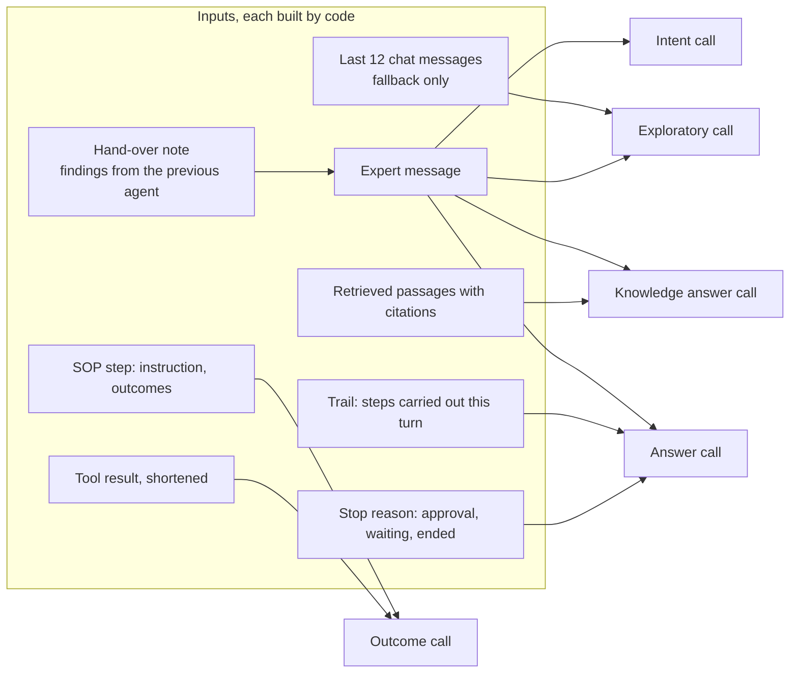

Design points worth knowing:

- **Decisions are constrained.** The model must call `report_outcome` with an **enum**. Small local
  models sometimes answer in plain text, so the reply is also parsed for JSON or for exactly one
  allowed word. Anything else is `unclear`, and the system asks the expert instead of guessing.
- **The SOP path does not replay the chat history.** Its context is the SOP step, the tool result,
  and the trail of this turn. Continuity across turns comes from the **saved SOP position**, not
  from the transcript. Only the exploratory fallback uses the last 12 messages.
- **Hand-over carries the findings.** The next agent's message starts with a short note of what was
  checked and what it showed, so it does not repeat the work.
- **The answer can only use what is in the prompt.** That is why every fact in the answer prompt
  carries a citation, and why the prompt says never to claim an action that is not in the facts.
- **Sizes are bounded:** tool results and passages are cut to 1,200 characters, a hand-over note to
  600, a message to 4,000.

---

## 11. Memory and state

| Layer | What | Where | Status |
|---|---|---|---|
| Turn context | Trail of the current turn: steps, tool results, outcomes | In the agent, for one turn | ✅ |
| Agent state | Where an agent stopped: SOP, step, awaiting expert or consent, pending request | Orchestrator, stored with the session and sent back with the next request | ✅ |
| Short-term memory | The case: full chat history, active agent, each agent's state, the pending approval, the audit log | Postgres `agent.session`, written after every turn and before an approval runs | ✅ |
| Context window | Agents receive only the last 12 messages | Orchestrator | ✅ |
| Cross-session recall | The customer's earlier cases, listed and resumable (`GET /v1/sessions?customer_id=`) | Chat UI sidebar | ✅ |
| Long-term customer memory | LLM-written case summaries, recalled when a new case starts | Postgres `memory` schema (created, empty) | 🔜 |
| Cache | Embeddings, retrieval results, hot sessions, rate limits | Valkey (running, unused) | 🔜 |

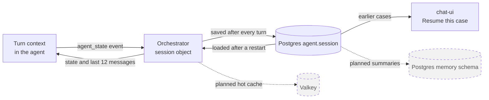

A session is loaded from the database the first time it is asked for after a restart. CI restarts
the orchestrator and checks that the case, the audit entry and the active agent are intact.

---

## 12. Observability

One chat turn is **one OpenTelemetry trace** that crosses the services (the W3C `traceparent`
header travels from the orchestrator to the agents). It is exported over OTLP to Jaeger. Tracing is
off when `OTEL_EXPORTER_OTLP_ENDPOINT` is not set, and every helper is then a no-op.

```text
POST /v1/sessions/{id}/messages                orchestrator, the request
└── turn                                        session, customer, correlation id
    ├── agent.call  inhome-agent                agent, resumes state, consent
    │   └── POST /v1/diagnose                   the agent's request span
    │       ├── workflow.intent
    │       │   └── llm.chat                    model, first-token ms, tokens
    │       ├── sop.step S1                     sop.id, sop.tool, sop.outcome
    │       │   ├── mcp.call_tool               tool name, duration, errors
    │       │   └── llm.chat
    │       └── workflow.compose                sop.stop
    └── agent.call  access-pon-agent            after a hand-over
        └── ...
```

The chat UI links each answer to its trace. Logs are structured JSON and carry the correlation id
and session id. CI fails if the hand-over turn does not appear in Jaeger across the orchestrator and
both agents, with SOP steps, LLM calls and tool calls. Not built: Langfuse, feedback scores,
metrics dashboards 🔜.

---

## 13. Safety controls and known gaps

| Control | Enforced by |
|---|---|
| A state-changing step needs approval and a `declined` outcome | SOP validator, in CI and at ingestion |
| Only the pending approval can be decided, once, with no arguments | Orchestrator and the agent's `act` node |
| The approved action must match the SOP step and the customer | `act` node re-validation |
| The fallback can only call read-only tools | Tool loading filters on `readOnlyHint` |
| The model cannot pick the customer | `customer_id` is injected by code and hidden from tool schemas |
| The model cannot choose the path | Outcomes are an enum, next steps come from the navigator |
| No knowledge means no model answer | Relevance gate and the fixed reply |
| Uploads cannot become procedures or be changed by agents | Reference-only documents, plain HTTP routes, not MCP tools |
| Bounded work | 15 steps and 3 procedures per turn, 2 hand-overs, 12 history messages, 15 MB uploads, timeouts |
| Auditability | Consent log in the session, one trace per turn |

**Known gaps** (acceptable for a local POC, not for production):

- No **authentication**: anyone who reaches the ports can use the chat, approve actions and upload.
  The ports are bound to localhost. The approver is a typed name.
- No **guardrails** against **prompt injection**: text from an uploaded document goes into the
  prompt as a passage. The model cannot run tools because of it (tools come from SOPs), but it could
  be misled in its wording.
- No **rate limiting**, no input scope gate, no PII handling or retention policy.
- The knowledge upload and delete routes are open on localhost.
- Qwen3-4B is a small model: outcome decisions can be wrong. That is why `unclear` exists and why
  an expert confirms every change.
- Not tested on Windows, macOS or ARM, and not tested at load.

---

## 14. Deployment and CI

Everything runs from one [`docker-compose.yml`](../docker-compose.yml). Ports are bound to
`127.0.0.1`. Two named volumes hold the state: `ollama_models` and `postgres_data`.

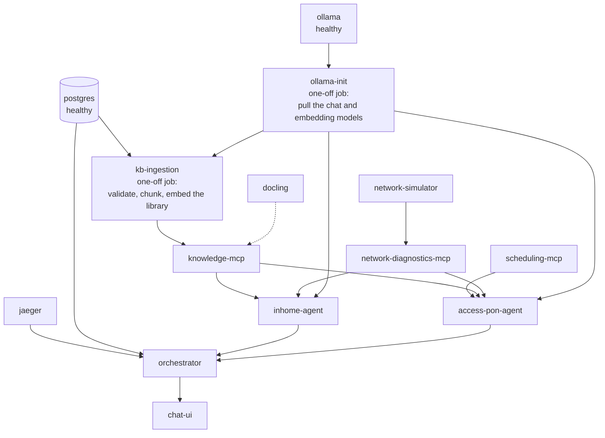

`docker compose up -d` waits for these conditions, so the first start blocks until the models are
downloaded. The 15 containers are: chat-ui, orchestrator, inhome-agent, access-pon-agent,
network-diagnostics-mcp, scheduling-mcp, knowledge-mcp, network-simulator, postgres, ollama, docling,
jaeger, valkey and the two one-off jobs. Postgres loads the `vector`, `pg_trgm` and `unaccent`
extensions and creates the `kb`, `agent` and `memory` schemas (`pg_trgm`, `unaccent` and `memory`
are prepared for later).

**CI** ([`.github/workflows/ci.yml`](../.github/workflows/ci.yml)) on every push:

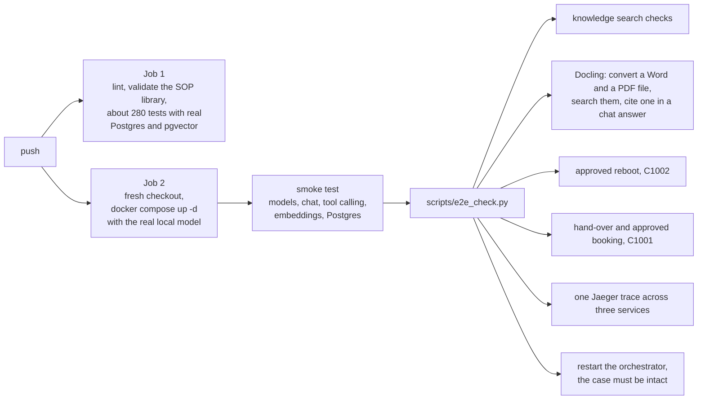

---

## 15. Planned work

Everything below is **not built**. Each item lists the existing groundwork.

| # | Item | Design sketch | Groundwork already there |
|---|---|---|---|
| 1 | **Cache (Valkey)** | Cache-only use, so data loss is acceptable. **Embedding cache** (key: model + text hash, so repeated questions skip the model call). **Retrieval cache** keyed by query, filters and the **library checksum**, so it is invalidated on every ingest. **Hot session cache** in front of Postgres. **Per-expert rate limits** and an **idempotency key** for approvals | Container runs with `maxmemory 256mb`, `allkeys-lru`, no persistence; `VALKEY_URL` in the config |
| 2 | **Access-P2P and Access-Copper agents** | Two more `AgentSpec` wrappers on the same engine (about 30 lines each), compose entries, router entries: EoF and GoF to P2P, VDSL to copper | SOP-P2P-001 and SOP-CU-001 are written and validated; scenarios C1004 and C1005 exist; `AGENTS` already lists them |
| 3 | **installed-base-mcp and quickscan-service** | The installed-base MCP replaces the simulator lookup for the carrier technology. The quick scan runs first measurements before the agent is chosen | Config URLs, tool in the catalog, simulator endpoint |
| 4 | **ticketing-mcp** | `create_incident`, `create_swap_order`, both needing approval. Closes the "not part of this demo" stops in the escalation and modem-replacement SOPs | SOP-ESC-001 and SOP-IH-003 reference them; catalog entries; consent flow ready |
| 5 | **Guardrails and identity** | Input scope gate, prompt-injection screening of retrieved text, Traefik in front, **Keycloak** (OIDC) for logins so the approver is a real identity, rate limits | Audit log structure, correlation ids |
| 6 | **Evaluation** | A golden set of questions with expected documents (recall at k, MRR), citation correctness and faithfulness scoring, SOP path tests with the real model, run in CI | A few retrieval checks in the e2e script; real-model tests exist but are informational |
| 7 | **Retrieval upgrades** | Cross-encoder **reranker** over the fused top 20, **query rewriting** with the conversation, parent-child chunk expansion. Add only if the evaluation shows a need | Retriever returns candidates and scores; `candidates` is configurable |
| 8 | **Long-term memory** | At case end the model writes a short summary stored in the `memory` schema. At case start, recall the customer's relevant summaries into the context | `memory` schema, session store, earlier-case listing |
| 9 | **More observability** | Langfuse for prompt-level views (needs six containers), thumbs up and down feedback scores, metrics and dashboards | OpenTelemetry spans for every LLM and tool call |
| 10 | **Document processing upgrades** | OCR for scanned PDFs, a review step before an upload becomes active, versions retired explicitly | Docling container, versioned uploads, source marking |
| 11 | **Model options** | A larger model, a GPU, per-task model routing (a small model for classification, a larger one for answers) | `OLLAMA_CHAT_MODEL`, GPU compose override |
| ⛔ | **Production readiness** | High availability, disaster recovery, secrets management, multi-tenancy, autoscaling, security hardening | Out of scope for this POC |

---

## 16. Design decisions and trade-offs

| Decision | Why | Cost |
|---|---|---|
| SOPs drive the flow; the model classifies and writes | Predictable, auditable, safe with a small local model | Less flexible than a free-form agent. New behaviour means writing an SOP |
| One SOP engine, specialists differ by scope | Adding an agent is small, behaviour stays consistent | The two agents are not independent programs |
| Rule-based routing in the orchestrator | Auditable and testable. The SOP and the carrier technology decide | New routing needs code, not a prompt |
| Agents are stateless, the orchestrator holds state | Agents can restart or scale freely. State is in one place | The orchestrator carries more responsibility |
| Retrieval behind MCP tools | Agents reach knowledge the same way as any other tool | Extra network hop |
| Postgres for vectors, text search and cases | One database fits a laptop | Not specialised. A vector database may be better at scale |
| Hybrid search with RRF and a relevance gate | Finds exact terms and meaning, and can answer "nothing found" | A fixed threshold needs tuning when the library grows |
| Server-Sent Events for streaming | Simple, one-way, works through proxies | No client-to-server channel, so decisions use separate POSTs |
| Jaeger instead of Langfuse | One small container, standard OpenTelemetry | No prompt-level analytics UI |
| Uploads are reference-only | An unreviewed file can inform but never instruct | A new procedure still needs a reviewed SOP |
| Official docling-serve image | Avoids building a multi-gigabyte PyTorch image | Large pull on first start |
