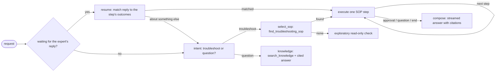

# inhome-agent

Specialist agent for problems inside the customer's home: modem, indicator lights, Wi-Fi settings
and connected devices. **SOP-first**: it follows NetCo's approved troubleshooting procedures from
the knowledge MCP server, step by step, and cites them.

## How a turn works



| Decision | Made by |
|---|---|
| Troubleshooting or knowledge question | LLM, choosing one of two options |
| Which procedure | Hybrid search (`find_troubleshooting_sop`) |
| Which tool a step runs | The SOP step (code calls the diagnostics MCP tool) |
| What the tool result means | LLM **function call** `report_outcome(outcome, reason)`; `outcome` is an enum of the step's allowed outcomes plus `unclear` |
| Which step comes next | `get_next_sop_step` on the knowledge server |
| Wording of the answer | LLM, streamed, citing steps such as `[SOP-IH-001 v1.0 › S2]` |

A turn stops at:

- a step that **needs approval** (reboot, Wi-Fi reset, factory reset, orders): a
  `consent_request` event is sent and the action is **not** carried out;
- a step for the **expert or customer** (for example "reconnect the device"), or a result the
  model calls `unclear`: the expert's next message is matched to that step's outcomes;
- the **end** of a procedure: resolved, escalate, or hand over (for example to the access network).
  "Continue with SOP-…" ends chain into the next procedure in the same turn.

The agent is stateless: its SOP position is sent as an `agent_state` event, kept by the
orchestrator and returned with the next request. If no procedure matches a troubleshooting
request, an **exploratory** LangGraph agent (free choice of read-only tools) checks the line and
says clearly that no SOP covers the problem.

## Events

`status_update` (`diagnosis_started`, `reasoning` with `purpose`, `intent`, `sop_selected`,
`sop_step`, `sop_outcome`, `sop_resume_skipped`, `no_sop`, `exploratory_started`, `thinking`),
`knowledge_article` (citation), `tool_call` (started / completed), `consent_request`,
`agent_message_delta` (answer tokens), `agent_message` (`final`), `agent_state`, `error`, `done`.

## API

```http
POST /v1/diagnose            # text/event-stream
{ "customer_id": "C1002", "message": "Customer has no internet", "session_id": "s1",
  "history": [], "state": null }

GET /health
```

## Run and test

```bash
uv run python -m inhome_agent                 # port 8201; needs the diagnostics and knowledge MCP servers
uv run pytest services/agents                 # scripted model, real MCP servers in memory
RUN_LLM_TESTS=1 uv run pytest services/agents # also runs the live-model test (needs Ollama)
```
